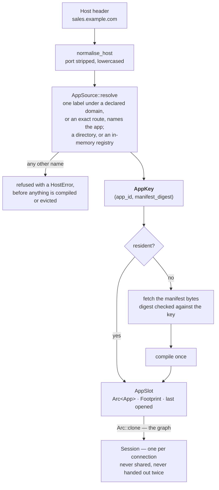
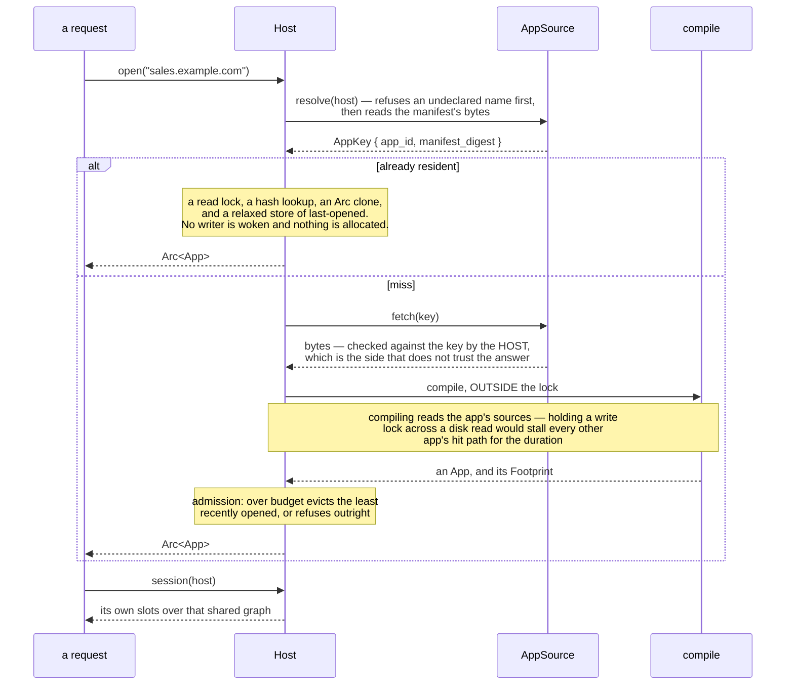

# dagpane-host — many apps in one process

`dagpane run` binds a port and serves one manifest. Hosting four hundred apps that way means
four hundred processes, which is already cheaper than four hundred Python containers — and
"cheaper" is a word, not a number. This crate is what makes it a number: **one process, `N`
apps, one compiled graph each, and a byte budget that decides which ones stay resident.**

`BENCHMARKS.md` has the number this crate exists for: **224 apps on one core**, at 448
concurrent sessions and 1 908 interactions per second, measured — against 200 predicted by a
service-demand model built from a separate rig that shares no code with it.

## The key is the whole design



`AppKey` names an app **and the manifest it was compiled from**, so a redeploy is a different
key rather than a mutation of the same one. Three things fall out of that, and none of them
needed a mechanism of its own:

* a viewer who reconnects after a deploy cannot be served the graph that was deployed over,
  because that graph is under a key nothing resolves to any more;
* a rollback is a key change, so the host does the work of a rollback by being told a
  different digest — there is no rollback path to get wrong;
* two processes holding one key hold the same graph, because the key names the bytes.

`AppId` is a DNS label, validated on construction and **not normalised**: `Sales` is refused
rather than lowered to `sales`. An identifier that changes when you write it differently is
two identifiers wearing one name, and where that difference surfaces is a registry lookup
that misses and deploys a second copy.

**`AppSource::resolve` is also where a name is refused, and a source must answer only names
its operator declared.** A `Host` header is chosen by whoever controls DNS for the name: a page
whose name was pointed at this machine sends that name as both `Host` and `Origin`, and nothing
after `resolve` can tell its request from a real one. `MemAppSource` is an exact table, bounded
by construction. `DirAppSource` is a pattern, so it is bounded to declared names — one label in
front of `localhost` or of a `Domain` passed to `with_domains` — and refuses every other name as
`HostError::OutsideDomains` before it touches a file. `Host::open` and `Host::open_session`
resolve before they do anything else, so nothing is compiled or evicted for a refused name. A
source written any other way — a suffix, a fallback app — owes the same: bounded to declared
names, and refusing before any I/O. ADR-0012.

## Event flow

One request resolving to a session. The hit path is the one to read first — it is what happens
several hundred times a second.



The last exchange is the one with no alternative branch, and that is the point: there is no
path here that hands back a session somebody else is also holding.

## Isolation: the graph is shared, the session is not

One process serving many parties' apps makes isolation a property of a data structure rather
than of a database, and the rule is one line. `Host::open` hands out `Arc<App>` — immutable,
compiled once — and every connection builds its own `dagpane_core::Session` over it.

**There is deliberately no call here that returns a session somebody else is also holding**,
because that is not a cache hit: it is one viewer reading another viewer's inputs.

`tests/isolation.rs` is that sentence made adversarial — thirteen tests, including the *same
manifest bytes* deployed under two app ids with both sessions open, one setting an input and
the other's panes asserted not to move. It runs with nothing listening on anything, which is
the point of the crate having no runtime in it: a runtime here would make the isolation test
the kind that needs a socket, and that is exactly the test that then gets skipped.
`ARCHITECTURE.md` §2 states the same rule from the workspace's side.

## The budget is bytes, because bytes are what was measured

Eviction is a byte budget rather than a count or an LRU guess, and that is only possible
because `Frame::memory_size` is a number every backend answers about its own storage. So
"what does this app cost" has an answer that was measured rather than assumed.

`Footprint` is three numbers. `source_bytes` is the one that decides; `source_rows` and
`cells` are what a person reads when they want to know *why* an app is expensive.

**`source_bytes` is the app's data, not the process's.** It excludes the graph's nodes, the
compiled pipelines, every session's slot vector and the allocator's slack. Those are real and
they are not in it — for the reason the crate exists: the sources are what a second *app*
adds and a second *viewer* does not, so they are what a budget over apps can honestly be
written in. Nothing here predicts RSS from it.

| `EvictReason` | when |
|---|---|
| `Redeployed` | a new manifest was published for this app. The old key goes immediately and is not left to be found. |
| `OverBudget` | admission would exceed `max_bytes`, and this was the least recently opened |
| `Idle` | nobody opened it within `idle_after`, **and a sweep ran** |

Two rules about that table are worth keeping:

* **An app larger than the whole budget is refused, not admitted and then evicted.** Admitting
  it would evict every other app first and still fail, which turns one oversized deploy into
  an outage for everything else on the node.
* **Nothing is evicted for being idle on the request path.** Only `sweep_idle` acts on
  `idle_after`, because the request path is the one place where the cost of being wrong is a
  user waiting for a recompile. A caller that never calls it gets no idle eviction at all.
  This crate owns no clock, so the timer is not here: `dagpane host` calls it through
  `dagpane_serve::sweep_idle`, at half the idle window, and prints what went. Until that
  caller existed, `--idle-minutes` on `main` configured a sweep that never ran; no release
  had `dagpane host` before 0.2.0, which ships with the caller.

`Budget::new` makes both numbers explicit at the call site — there is no default that is right
for two machines, and a host that picks one silently is a host whose eviction is a surprise.
Every eviction is recorded in a bounded log (`Host::evictions`) rather than inferred from a
later cache miss; unbounded, it would be a memory leak with a good excuse.

## What a viewer holds — reported, and deliberately not enforced

`source_bytes` is what a second *app* adds. What a second *viewer* adds is what their pipeline
materialises on top of the sources they share — about the rows again for a pipeline that keeps
rows, next to nothing for one that aggregates — and the budget does not count it. It is counted
here, from inside, rather than left to an RSS reading:

* **`Host::session` returns a `SessionLease` beside the session**, and `Host::open_session` is
  the same for a caller that builds its own session type, as `crates/serve` does. There is no
  way to get a session from a `Host` without one. The host keeps a `Weak` to it, so a viewer is
  counted for exactly as long as the lease is held, and a connection that ends takes itself
  off the list with nothing to remember to call.
* **`SessionLease::record` prices the session** after a pass: every frame its slots hold, each
  allocation counted once, minus the app's own sources (`SharedBaseline`, computed once at
  admission). So a projection of a source costs nothing, a filter is billed for its rows and
  not for the dictionary it kept, and two slices of one buffer are one buffer. It is an atomic
  store; the interaction path takes no lock for it.
* **`Host::sessions` and `Host::session_bytes`** are what `dagpane host` reports in `/healthz`.
  Each `LiveSession` names its key *and its admission* — a key evicted and opened again is a
  second compile and a second copy of its sources, and a viewer who connected before the
  eviction is still on the first.

`benches/sessions/ledger.sh` checks the figure against the kernel's: what it leaves out is a
per-connection floor that stays put while the figure moves by orders of magnitude between
apps. `BENCHMARKS.md`, *What one more viewer costs*, has the table.

**Nothing acts on it, and that is a decision rather than an omission.** The budget evicts
*apps*, and evicting an app frees nothing its viewers hold: their graph keeps its sources alive
until they leave, which is why `/healthz` lists such admissions apart, as `held_after_eviction`.
A budget that counted viewers and evicted apps to get under it would evict, free nothing, and
recompile the app — a second copy — for the next viewer who asked. Enforcing a limit on what
viewers hold means refusing or shedding *viewers*, which is a different policy from the one
this crate implements; `ROADMAP.md` §7 keeps it as an open box.

## Quickstart

```sh
dagpane host ./apps --budget-mb 512 --idle-minutes 60
```

`apps/sales.toml` becomes the app `sales`, reachable at `sales.localhost:8787` and, with
`--domain example.com`, at `sales.example.com` too — exactly one label, the app, in front of a
declared domain. Any other name gets `404` before anything is read: a bare `Host: sales`, an
address such as `127.0.0.1` or `[::1]`, `x.sales.localhost`, and `sales.attacker.example` or
`sales` in front of any other domain nobody declared. A filename that is not a DNS label is
skipped and reported at start-up. Editing a manifest changes its digest, so the next request
compiles the new one and the old graph is evicted: **there is no deploy step.**

```rust
use std::sync::Arc;
use std::time::Duration;
use dagpane_host::{Budget, DirAppSource, Domain, Host, HostError};

// `<app>.localhost` always; each declared domain adds `<app>.<domain>`.
let source = DirAppSource::new("./apps").with_domains([Domain::parse("example.com")?]);
let host = Host::new(Arc::new(source), Budget::new(512 << 20, Duration::from_secs(3600)));

let app = host.open("sales.localhost")?;      // compiles on the first open, then Arc::clone
// This viewer's own slots over that graph, and the lease that lets the host count them.
let (mut session, lease) = host.session("sales.localhost")?;
session.refresh();
lease.record(&session);                       // what this viewer holds beyond the sources
println!("{} bytes across {} viewer(s)", host.session_bytes(), host.sessions().len());

// A bare name, an address, a domain nobody declared: refused before a file is touched.
for name in ["sales", "127.0.0.1", "sales.attacker.example"] {
    assert!(matches!(host.open(name), Err(HostError::OutsideDomains(_))));
}

for gone in host.sweep_idle() {
    eprintln!("evicted {} — {} ({} bytes)", gone.key, gone.reason, gone.bytes);
}
```

```sh
cargo test -p dagpane-host
```

## A refresh is not a redeploy

`Host::reload` is what a scheduled refresh does to the map: an admission's app over new rows —
`App::with_sources` — replaces its resident slot under the **same key and the same admission**,
so the next viewer opens on the new rows, `resident_bytes` counts what the app holds now, and
growing evicts others exactly as an admission would. One that would not fit in the whole
budget on its own is refused and the old rows stay. An admission evicted while viewers held it
has no slot to replace, and the answer is still what those viewers' leases need:
`SessionLease::rebase` moves a lease's baseline onto the new rows, without which every viewer
would be billed for the refreshed table as though it were theirs. When to read is not this
crate's question — it has no clock — and `crates/serve` asks it. `tests/refresh.rs`.

## Deliberately absent

No socket, no async runtime, and no clock beyond `std::time::Instant`. Multiplexing is a
decision about a map — which key, which lifetime, which budget — and every one of those
decisions is testable with nothing listening on anything. `crates/serve` owns the socket and
drives this.
